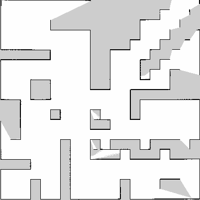
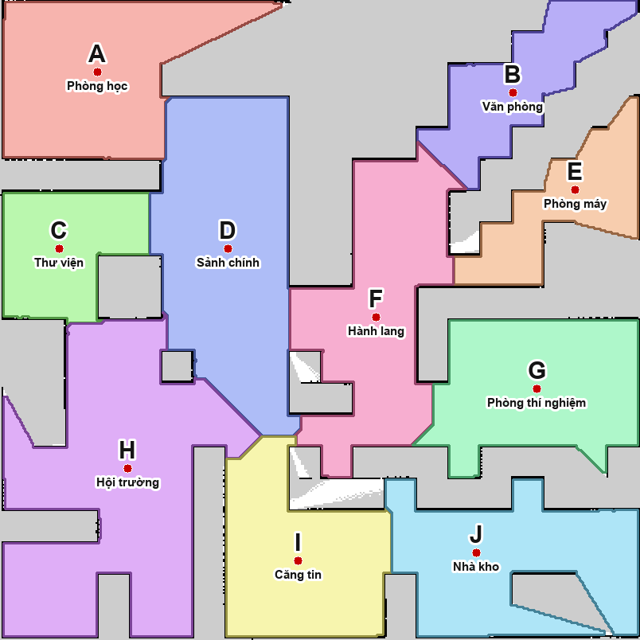

# turtlebot4_bai07 — Bài 07: map segmentation and voice navigation

TurtleBot 4 Lite in Ignition Gazebo (ROS 2 Humble): the map built in
[bài 04](https://github.com/Khanhkhan1/turtlebot4_bai04) is split into labelled regions with OpenCV,
a Vietnamese voice command is turned into text with Vosk (offline), and the robot is sent to the
named region with Nav2 (`NavigateToPose`), avoiding obstacles that are not on the map
(`worlds/maze_obstacles.sdf`: the bài 04 maze + 4 obstacles).

**Video demo:** https://drive.google.com/file/d/10A8BkOyYn-wqBQhxQcB699cY3sgc1RgO/view?usp=sharing

```
maps/map.pgm + map.yaml --segment_map (OpenCV)--> maps/regions.yaml, regions_label.png, regions.png
                              config/semantic_labels.yaml (names) --^
microphone --speech_recognition_node (Vosk)--> /voice/text --> voice_navigator --NavigateToPose--> Nav2
                                     TF map->base_link (AMCL) --^      `--> /regions/markers (RViz2)
```

| Original map `maps/map.png` | Segmented map `maps/regions.png` |
|---|---|
|  |  |

## Regions

| | A | B | C | D | E | F | G | H | I | J |
|---|---|---|---|---|---|---|---|---|---|---|
| Name | Phòng học | Văn phòng | Thư viện | Sảnh chính | Phòng máy | Hành lang | Phòng thí nghiệm | Hội trường | Căng tin | Nhà kho |

Segmentation: free cells → distance transform → the free space is eroded step by step and every
part that comes loose (a room core, 0.4–5 m²) is a seed → each free cell joins the nearest seed
through free space (watershed that does not cross walls) → regions under 14 m² are merged.
Names come from `config/semantic_labels.yaml` (one point per region). Each region in
`maps/regions.yaml` has its label, name, goal point (map frame, far from walls), centre, area and outline.

## Voice commands

- `Đi đến khu vực A.` / `Đi đến phòng thí nghiệm.` → that region.
- `Di chuyển từ khu vực A đến khu vực B.` → B if the robot is in A, otherwise A then B.
- `Dừng lại.` → cancel. A place not on the map (`Đi đến khu vực Z`, `Đi đến phòng ngủ`) is reported,
  the robot does not move. A new command replaces the running one.

Region names are recognized more reliably than single letters.

## Build

```bash
cd ~/tb4_ws/src && git clone https://github.com/Khanhkhan1/turtlebot4_bai07.git
vcs import . < turtlebot4_bai07/dependencies.repos   # turtlebot4_bai04, turtlebot4, simulator, create3_sim
pip install vosk sounddevice                          # Vosk model (32 MB) downloads on first run
cd ~/tb4_ws && colcon build && source install/setup.bash
```

## Run

```bash
export ROS_LOCALHOST_ONLY=1 IGN_IP=127.0.0.1          # in every terminal

ros2 launch turtlebot4_bai07 bai07.launch.py           # Gazebo, AMCL + Nav2, RViz2, both nodes; speak a command
                                                       # (macOS: allow microphone access for the terminal)
ros2 launch turtlebot4_bai07 bai07.launch.py mic:=false   # no microphone, then:
ros2 topic pub --once /voice/wav std_msgs/msg/String "{data: /path/command.wav}"   # 16-bit mono wav
ros2 topic pub --once /voice/text std_msgs/msg/String "{data: 'đi đến phòng thí nghiệm'}"

cd ~/tb4_ws/src/turtlebot4_bai07 && ros2 run turtlebot4_bai07 segment_map maps/map.yaml \
    --labels config/semantic_labels.yaml               # segment again (writes maps/regions.*)
python3 -m pytest test                                 # command parser tests
```
